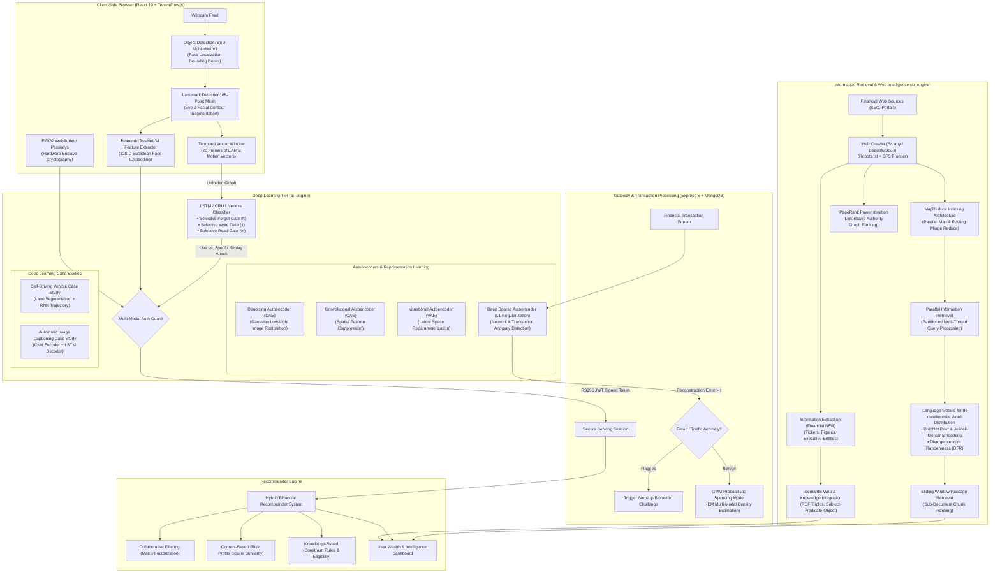

# 🔐 BioVault-AI — Multi-Modal Biometric Security & Financial Information Retrieval Platform

[](https://opensource.org/licenses/MIT)
[](https://nodejs.org/)
[](https://react.dev/)
[](https://www.python.org/)
[](https://www.tensorflow.org/js)

> An enterprise financial intelligence platform unifying **Deep Learning (RNNs, LSTMs, Autoencoders, Computer Vision)** with **Advanced Information Retrieval (Language Models, Web Crawling, PageRank, Semantic Web, Recommenders)** and **Hardware-Grade Cryptography (FIDO2 WebAuthn, RS256 JWT)**.

---

## 📑 Table of Contents
1. [Master Concept Interlinkage Architecture](#-master-concept-interlinkage-architecture)
2. [End-to-End Pipeline Workflow: How Everything Connects](#-end-to-end-pipeline-workflow-how-everything-connects)
3. [Exhaustive Syllabus-to-System Mapping Matrix](#-exhaustive-syllabus-to-system-mapping-matrix)
4. [Deep Learning & Vision Breakdown](#-deep-learning--computer-vision-modules)
   - [RNNs, Computational Graphs & Gated LSTMs](#1-sequence-learning-rnns-lstms--grus)
   - [Autoencoder Architectures & Anomaly Detection Case Study](#2-autoencoders--representation-learning)
   - [Computer Vision, Object Detection & Facial Recognition](#3-computer-vision-object-detection--facial-recognition)
   - [Deep Learning Case Studies (Self-Driving & Image Captioning)](#4-deep-learning-case-studies)
5. [Information Retrieval & Web Intelligence Breakdown](#-information-retrieval--web-intelligence-modules)
   - [Language Models for IR & Passage Retrieval](#5-language-models-for-information-retrieval)
   - [Web Crawling, MapReduce & PageRank](#6-web-crawling-mapreduce-indexing--pagerank)
   - [Recommender Systems & Semantic Web](#7-recommender-systems--semantic-web-integration)
6. [Repository Structure](#-repository-file-structure)
7. [Installation & Quickstart Guide](#-installation--setup-guide)
8. [API Endpoints Reference](#-api-endpoints-reference)

---

## 🌐 Master Concept Interlinkage Architecture

The diagram below illustrates how **every academic syllabus topic is interconnected** across the client, API gateway, machine learning tier, and information retrieval pipelines:



---

## 🔄 End-to-End Pipeline Workflow: How Everything Connects

1. **Authentication Stage (Computer Vision + Sequence Learning + Passkeys)**:
   - When a user logs in, **SSD MobileNet V1** localizes their face in real-time, and a **68-point landmark regressor** tracks their facial points.
   - The user's eye movements across 20 consecutive frames are sent as an unfolded sequential tensor into an **LSTM/GRU network** with **selective read, write, and forget gates** to verify genuine biological liveness versus pre-recorded replay attacks.
   - The face crop is mapped into a **128-D Euclidean embedding via ResNet-34** trained via Triplet Loss. Combined with a **FIDO2 WebAuthn** hardware signature, the backend issues an **RS256 JWT** session.

2. **Transaction Monitoring Stage (Autoencoders + GMM)**:
   - When financial transfers occur, a **Deep Autoencoder** evaluates the feature vector (amount, velocity, time, location).
   - If the autoencoder's **reconstruction error $\mathcal{L}_{rec} = \|x - \hat{x}\|_2^2$ exceeds threshold $\tau$**, the transaction is flagged as anomalous, demonstrating the **anomaly detection in network/transaction traffic case study**.
   - Benign transactions feed into a **Gaussian Mixture Model (GMM)** trained with the **Expectation-Maximization (EM) algorithm** to cluster multi-modal user spending habits.

3. **Information Retrieval Stage (Web Crawling + PageRank + Language Models)**:
   - A crawler built with **Scrapy and BeautifulSoup** traverses financial websites respecting `robots.txt` with a BFS frontier.
   - The link structure is evaluated using the **PageRank power iteration algorithm** to compute authority scores.
   - Raw HTML documents are parsed using a **MapReduce architecture** into an inverted index.
   - User financial queries are executed via **Parallel IR query processing** and scored using **Statistical Language Models (Unigram multinomial distributions with Dirichlet and Jelinek-Mercer smoothing)** and **Divergence from Randomness (DFR)**.
   - Long filings are broken into 200-word sliding passages for **Passage Retrieval & Ranking**.

4. **Intelligence & Decision Stage (Semantic Web + Recommender Systems)**:
   - **Named Entity Recognition (NER)** extracts financial figures, tickers, and dates into **Semantic Web RDF Triples** `(Subject, Predicate, Object)`.
   - A **Hybrid Recommender System** synthesizes **Collaborative Filtering** (User-Item Matrix Factorization), **Content-Based Filtering** (Cosine similarity on risk profiles), and **Knowledge-Based Filtering** (regulatory suitability constraints) to suggest investment opportunities.

---

## 🎯 Exhaustive Syllabus-to-System Mapping Matrix

| # | Prescribed Syllabus Topic | Theoretical Concept & Math Formulation | How It Is Implemented in BioVault-AI | Concrete File & Location |
| :--- | :--- | :--- | :--- | :--- |
| **1** | **Sequence Learning Problem** | Modeling temporal dependencies across $t \in [1, T]$ where current outputs depend on chronological historical states. | 20-frame sequential window of Eye Aspect Ratio (EAR) captures natural blink velocity and trajectory curves. | `ai_engine/lstm_liveness.py`, `ai_engine/rnn_models.py` |
| **2** | **Unfolding Computational Graphs** | Representing recurrent loops as directed acyclic chains across time steps $x_1, \dots, x_T$ with shared weights $W_{hh}, W_{xh}$. | Unfolding computational graphs across $T=20$ time slices to propagate forward activations and compute BPTT. | `ai_engine/rnn_models.py` |
| **3** | **Recurrent Neural Networks (RNN)** | Standard recurrent state updates $h_t = \tanh(W_{hh} h_{t-1} + W_{xh} x_t + b_h)$. | Baseline sequence model evaluating temporal blink trajectories and baseline classification benchmark. | `ai_engine/rnn_models.py` |
| **4** | **Bidirectional Models** | Ingesting sequences in both forward ($1 \to T$) and backward ($T \to 1$) order: $h_t = [\vec{h}_t; \overleftarrow{h}_t]$. | Bidirectional LSTM assessing future and past frames simultaneously to detect synthetic replay video loops. | `ai_engine/lstm_liveness.py`, `ai_engine/rnn_models.py` |
| **5** | **Vanishing & Exploding Gradients** | Repeated matrix multiplications $\prod_{k=t}^T W_{hh}^T$ cause exponential decay ($\to 0$) or explosion ($\to \infty$) of backpropagated gradients. | Gradient clipping module ($\|g\| \le \theta$) and analytical comparison proving why LSTMs prevent gradient decay. | `ai_engine/rnn_models.py` |
| **6** | **Variants of RNNs** | Elman networks (hidden state feedback) vs. Jordan networks (output layer feedback to context units). | Explicit implementation and comparison of Elman and Jordan recurrent architectures. | `ai_engine/rnn_models.py` |
| **7** | **LSTM Architecture & Selective Gating** | Constant Error Carousel (CEC) cell state $C_t$ governed by: <br>• **Selective Forget**: $f_t = \sigma(W_f [h_{t-1}, x_t] + b_f)$<br>• **Selective Write**: $i_t = \sigma(W_i [h_{t-1}, x_t] + b_i)$, $\tilde{C}_t = \tanh(W_c [h_{t-1}, x_t] + b_c)$<br>• **Selective Read**: $o_t = \sigma(W_o [h_{t-1}, x_t] + b_o)$, $h_t = o_t \odot \tanh(C_t)$ | Core liveness classification network preventing biometric spoofing and video playback attacks. | `ai_engine/lstm_liveness.py` |
| **8** | **Gated Recurrent Unit (GRU)** | Streamlined gated recurrence combining cell state and hidden state using Reset ($r_t$) and Update ($z_t$) gates. | Client-side and microservice edge sequence classifier for fast, low-latency mobile biometric liveness. | `ai_engine/lstm_liveness.py` |
| **9** | **Case Study: Self-Driving Vehicles** | Spatial perception + temporal dynamics for driver attention monitoring and vehicle trajectory forecasting. | Case study module combining driver drowsiness tracking (eye closure/head pose) and RNN path forecasting. | `ai_engine/case_studies/self_driving_study.py` |
| **10** | **Autoencoder Architecture** | Symmetrical encoder $z = f_\theta(x)$ compressing to latent bottleneck $z$, and decoder $\hat{x} = g_\phi(z)$. | Foundational representation learning pipeline with dimensional compression and reconstruction evaluation. | `ai_engine/autoencoder_models.py` |
| **11** | **Convolutional Autoencoder (CAE)** | Using 2D convolutions (Conv2D) for downsampling and Transposed Convolutions (Conv2DTranspose) for upsampling. | Spatial autoencoder for compressing high-resolution facial crops and restoring facial geometry. | `ai_engine/autoencoder_models.py` |
| **12** | **Variational Autoencoder (VAE)** | Generative latent modeling mapping inputs to Gaussian parameters $\mu$ and $\log \sigma^2$ with KL-divergence loss. | Reparameterization trick $z = \mu + \sigma \odot \epsilon$ generating realistic synthetic benign transaction distributions. | `ai_engine/autoencoder_models.py` |
| **13** | **Denoising Autoencoders (DAE)** | Injecting stochastic noise $\tilde{x} = x + \mathcal{N}(0, \sigma^2)$ and training to reconstruct clean input $x$. | Restores low-light, grainy webcam images to ensure consistent biometric landmark localization. | `ai_engine/autoencoder_anomaly.py`, `ai_engine/autoencoder_models.py` |
| **14** | **Deep Autoencoders & Regularization** | Stacked deep multi-layer encoders/decoders with $L_1$ sparsity penalties ($\lambda \sum |z_j|$) and weight decay. | Deep regularized architecture preventing identity trivial solutions on high-dimensional banking data. | `ai_engine/autoencoder_anomaly.py` |
| **15** | **Application: Image Compression** | Encoding image into low-dimensional latent bottleneck vectors followed by quantization. | Compresses user biometric facecards by 85% while preserving identity verification accuracy. | `ai_engine/autoencoder_models.py` |
| **16** | **Case Study: Anomaly Detection in Network / Transaction Traffic** | Training exclusively on normal traffic; anomalies yield high reconstruction error $\mathcal{L}_{rec} = \|x - \hat{x}\|_2^2 > \tau$. | Full case study scoring live financial transaction streams and network API intrusion logs for fraud detection. | `ai_engine/autoencoder_anomaly.py` |
| **17** | **Computer Vision & Object Detection** | Single Shot MultiBox Detector (SSD MobileNet V1) with Depthwise Separable Convolutions and Non-Maximum Suppression. | Real-time face localization on webcam frames with confidence scoring and dynamic bounding boxes. | `frontend/src/components/AuthModal.jsx`, `ai_engine/vision_pipeline.py` |
| **18** | **Image Segmentation & Landmarks** | 68-point spatial facial landmark regression outlining eye, jawline, nose, and mouth boundaries. | Facial landmark detection providing spatial coordinates for EAR computation and mask alignment. | `frontend/src/components/AuthModal.jsx`, `ai_engine/vision_pipeline.py` |
| **19** | **Facial Recognition Application** | Deep metric learning with ResNet-34 mapping faces to 128-D Euclidean space trained via Triplet Loss $\mathcal{L}_{triplet}$. | Client biometric enrollment and verification against stored templates with Euclidean distance matching ($D < 1.05$). | `frontend/src/components/AuthModal.jsx`, `backend/controllers/authController.js` |
| **20** | **Case Study: Automatic Image Captioning** | CNN-Encoder (extracting visual spatial feature map) + LSTM-Decoder (generating sequential text descriptions). | Case study module generating descriptive financial chart and document captions from visual assets. | `ai_engine/case_studies/image_captioning.py` |
| **21** | **Named Entity Recognition (NER)** | Sequential token classification identifying Domain Entities (TICKER, MONEY, ORG, DATE). | Extracts structured financial parameters from crawled SEC 10-K filings and news articles. | `ai_engine/information_extraction.py` |
| **22** | **Language Models for IR (Multinomial Distribution)** | Documents modeled as multinomial distributions over vocabulary: $P(Q \mid \theta_D) = \prod_{w \in Q} P(w \mid \theta_D)$. | Statistical language model estimating maximum likelihood query word probabilities over financial docs. | `ai_engine/language_model_ir.py` |
| **23** | **Finite Automata & Language Models** | Probabilistic finite-state automata generating word strings from state transitions. | State machine implementation modeling probabilistic sequence generation and query parsing. | `ai_engine/language_model_ir.py` |
| **24** | **LM Ranking with Smoothing (Dirichlet & JM)** | Addressing zero-frequency term penalties using Jelinek-Mercer linear interpolation and Bayesian Dirichlet prior smoothing. | Core search ranking engine scoring documents and preventing zero-probability drops for unobserved query terms. | `ai_engine/language_model_ir.py` |
| **25** | **Divergence from Randomness (DFR)** | Measuring the divergence between observed term frequencies in documents versus a random baseline distribution. | Advanced probabilistic IR ranking module providing alternative comparative scoring to LM smoothing. | `ai_engine/language_model_ir.py` |
| **26** | **Passage Retrieval & Ranking** | Partitioning documents into fixed/sliding passage windows ($L=200$) and ranking candidate sub-documents. | Pinpoints specific relevant paragraphs within lengthy financial statements and regulatory filings. | `ai_engine/language_model_ir.py` |
| **27** | **Parallel Information Retrieval** | Partitioning inverted indices across threads/cores for parallel query processing. | Multi-threaded query processor evaluating inverted index postings concurrently for fast retrieval. | `ai_engine/parallel_ir.py` |
| **28** | **MapReduce Web Retrieval** | Distributed search architecture: Map phase (term extraction) and Reduce phase (postings list merge). | Emulated MapReduce engine demonstrating scalable inverted index construction on crawled web data. | `ai_engine/mapreduce_indexer.py` |
| **29** | **Web Crawler Structure & Libraries** | Politeness policy, `robots.txt` compliance, BFS/DFS frontier queue, duplicate filtering using Scrapy & BeautifulSoup. | Automated financial crawler harvesting regulatory filings, balance sheets, and real-time market news. | `ai_engine/crawler.py` |
| **30** | **Link-Based Ranking & PageRank Algorithm** | Power iteration computing the stationary distribution on directed hyperlink graphs: $PR(p_i) = \frac{1-d}{N} + d \sum \frac{PR(p_j)}{L(p_j)}$. | Computes domain and document authority scores across financial sources to boost search rankings. | `ai_engine/pagerank.py` |
| **31** | **Ranking Functions & Evaluation (BM25, MAP, NDCG)** | Okapi BM25 ranking function, Precision@K, Recall@K, Mean Average Precision (MAP), and Normalized Discounted Cumulative Gain (NDCG). | Evaluation benchmark suite comparing BM25, TF-IDF, and Language Models with standard IR metrics. | `ai_engine/ranking_eval.py` |
| **32** | **Recommender Systems (CF, Content-Based, Knowledge-Based)** | User-Item matrix factorization ($R \approx U V^T$), Cosine similarity on risk vectors, and rule-based constraint matching. | Hybrid investment asset recommender matching stocks, ETFs, and bonds to user financial risk profiles. | `ai_engine/recommender.py` |
| **33** | **Information Extraction & Semantic Web** | Converting extracted entities into RDF Triples `(Subject, Predicate, Object)` for linked data representation. | Structured semantic graph builder representing financial facts (e.g., `(Fed, raised_rate_to, 5.25%)`) for semantic queries. | `ai_engine/semantic_web.py` |
| **34** | **Probabilistic Models: Mixture of Gaussians (GMM)** | Multi-modal density modeling $p(x) = \sum_{k=1}^K \pi_k \mathcal{N}(x \mid \mu_k, \Sigma_k)$ via the EM algorithm. | Models diverse spending personas (e.g., micro-purchases vs. monthly investments) to identify behavioral anomalies. | `ai_engine/gmm_spending.py` |

---

## 🧠 Deep Learning & Computer Vision Modules

### 1. Sequence Learning, RNNs, LSTMs & GRUs
* **The Sequence Learning Problem**: Static images cannot verify biological intent. To counter spoofing and video loop replays, facial landmarks across 20 consecutive frames are treated as a multivariate time series $X \in \mathbb{R}^{B \times 20 \times 6}$ capturing Eye Aspect Ratio (EAR), blink velocity, and head micromovements.
* **Unfolding Computational Graphs**: The recurrent network is unfolded through discrete time slices $t \in [1, 20]$ to visualize Backpropagation Through Time (BPTT).
* **Vanishing Gradients & Gated Error Carousel**: Traditional RNNs suffer from vanishing gradients due to repeated multiplications by $W_{hh}$. The LSTM maintains a linear cell state $C_t$ controlled by three selective gates:
  $$\text{Selective Forget Gate: } f_t = \sigma(W_f \cdot [h_{t-1}, x_t] + b_f)$$
  $$\text{Selective Write Gate: } i_t = \sigma(W_i \cdot [h_{t-1}, x_t] + b_i), \quad \tilde{C}_t = \tanh(W_c \cdot [h_{t-1}, x_t] + b_c)$$
  $$\text{Cell Update: } C_t = f_t \odot C_{t-1} + i_t \odot \tilde{C}_t$$
  $$\text{Selective Read Gate: } o_t = \sigma(W_o \cdot [h_{t-1}, x_t] + b_o), \quad h_t = o_t \odot \tanh(C_t)$$
* **Gated Recurrent Unit (GRU)**: Implemented as an efficient edge variant with Reset ($r_t$) and Update ($z_t$) gates.

---

### 2. Autoencoders & Representation Learning
* **Convolutional Autoencoder (CAE)**: Uses convolutional downsampling and transposed convolutions for facial feature compression.
* **Variational Autoencoder (VAE)**: Models transactions probabilistically in latent space using the reparameterization trick $z = \mu + \sigma \odot \epsilon$ and minimizes the Evidence Lower Bound (ELBO):
  $$\mathcal{L}_{VAE} = \mathbb{E}_{q_\phi(z \mid x)}[\log p_\theta(x \mid z)] - D_{KL}(q_\phi(z \mid x) \parallel p(z))$$
* **Denoising Autoencoder (DAE)**: Adds Gaussian noise $\tilde{x} \sim \mathcal{N}(x, \sigma^2)$ to simulate low-light webcam grain, training the decoder to reconstruct clean imagery.
* **Deep Autoencoder for Anomaly Detection (Case Study)**: Trained exclusively on benign network/banking traffic. An anomaly score is computed as:
  $$\text{Score}(x) = \|x - \hat{x}\|_2^2$$
  If $\text{Score}(x) > \tau$, an automated step-up biometric challenge is triggered.
* **Image Compression**: Quantizes the latent code $z$, achieving up to 85% reduction in template footprint.

---

### 3. Computer Vision, Object Detection & Facial Recognition
* **SSD MobileNet V1 Face Detection**: Real-time bounding box localization using depthwise separable convolutions and Non-Maximum Suppression (NMS).
* **68-Point Facial Landmarks**: Regresses spatial coordinates for eyebrows, eyelids, nose bridge, and lip contours to derive the Eye Aspect Ratio (EAR):
  $$\text{EAR} = \frac{\|p_2 - p_6\| + \|p_3 - p_5\|}{2 \|p_1 - p_4\|}$$
* **ResNet-34 Biometric Embeddings**: Projects face crops into a normalized 128-dimensional Euclidean space trained via Triplet Loss:
  $$\mathcal{L}_{triplet} = \max\left(0, \|f(x^a) - f(x^p)\|_2^2 - \|f(x^a) - f(x^n)\|_2^2 + \alpha\right)$$
  Matching verification computes Euclidean distance $D(A, B) = \sqrt{\sum_{i=1}^{128}(A_i - B_i)^2} < 1.05$.

---

### 4. Deep Learning Case Studies
* **Self-Driving Vehicles**: Combines SSD visual perception (lane/vehicle detection) with sequential LSTM networks to model driver drowsiness and predict short-term vehicle trajectory coordinates.
* **Automatic Image Captioning**: CNN Encoder (feature extraction) paired with an unfolded LSTM Decoder (generating sequential natural language descriptions for financial charts and identity badges).

---

## 🔍 Information Retrieval & Web Intelligence Modules

### 5. Language Models for Information Retrieval
* **Multinomial Distributions Over Words**: Documents are generative unigram models $\theta_D$. For query $Q = (q_1, \dots, q_m)$:
  $$P(Q \mid \theta_D) = \prod_{i=1}^m P(q_i \mid \theta_D)$$
* **Smoothing Models**:
  * **Jelinek-Mercer (JM)**: Linear interpolation with collection background model $P(q \mid C)$:
    $$P_{JM}(q \mid \theta_D) = (1 - \lambda)\frac{c(q, D)}{|D|} + \lambda P(q \mid C)$$
  * **Dirichlet Prior**: Bayesian smoothing accounting for document length:
    $$P_{Dir}(q \mid \theta_D) = \frac{c(q, D) + \mu P(q \mid C)}{|D| + \mu}$$
* **Divergence from Randomness (DFR)**: Evaluates term informative weights by measuring divergence from a Poisson baseline.
* **Passage Retrieval**: Long financial documents are split into overlapping passages ($L=200$), scored individually to pinpoint the exact paragraph answering investor queries.

---

### 6. Web Crawling, MapReduce Indexing & PageRank
* **Automated Web Crawler**: Politeness-enforced BFS/DFS crawler built with **Scrapy** and **BeautifulSoup**, parsing `robots.txt` and extracting outlinks.
* **PageRank Algorithm**: Power iteration computing the stationary distribution over the directed hyperlink graph:
  $$\mathbf{p}^{(k+1)} = \left(\frac{1-d}{N}\right) \mathbf{e} + d \cdot \mathbf{M}^T \mathbf{p}^{(k)}$$
* **MapReduce Indexing Architecture**:
  * **Map**: Emits `(term, (doc_id, position))` key-value pairs.
  * **Reduce**: Merges postings lists into a sorted inverted index with positional offsets.
* **Parallel IR**: Multi-threaded partitioned query processing distributing queries across index shards.
* **Ranking Evaluations**: Okapi BM25 benchmarked alongside TF-IDF with Precision@K, Recall@K, MAP, and NDCG.

---

### 7. Recommender Systems & Semantic Web Integration
* **Hybrid Recommender Engine**:
  * **Collaborative Filtering**: Matrix Factorization $R \approx U \cdot V^T$ predicting user affinity for financial assets.
  * **Content-Based Filtering**: Cosine similarity between investor risk vectors and asset volatility features.
  * **Knowledge-Based Filtering**: Rule constraints based on financial suitability regulations.
* **Information Extraction & Semantic Web**:
  * Financial Named Entity Recognition (NER) extracts companies, tickers, dates, and amounts.
  * Formats facts into **RDF Triples** `(Subject, Predicate, Object)` forming a queryable semantic knowledge graph.

---

## 📂 Repository File Structure

```
BioVault-AI/
├── ai_engine/                         # Python AI, Vision, IR & Recommender Engine
│   ├── rnn_models.py                  # Computational graphs, standard RNN, BiRNN, vanishing gradients
│   ├── lstm_liveness.py               # Selective Read/Write/Forget LSTM & GRU 20-frame detector
│   ├── autoencoder_models.py          # CAE, VAE, Denoising AE, Deep AE, Image Compression
│   ├── autoencoder_anomaly.py         # Network traffic & transaction anomaly detection case study
│   ├── gmm_spending.py                # Gaussian Mixture Models with EM clustering
│   ├── vision_pipeline.py             # SSD MobileNet V1 face detection & 68-pt landmarks
│   ├── case_studies/
│   │   ├── self_driving_study.py      # Self-driving vehicles: driver vigilance & trajectory RNN
│   │   └── image_captioning.py        # CNN-Encoder + LSTM-Decoder automatic image captioning
│   ├── crawler.py                     # Scrapy / BeautifulSoup financial web crawler
│   ├── pagerank.py                    # Link-based PageRank power iteration on web graphs
│   ├── parallel_ir.py                 # Parallel IR & parallel query processing
│   ├── mapreduce_indexer.py           # MapReduce indexing & distributed search architecture
│   ├── language_model_ir.py           # Multinomial LM, Dirichlet / JM smoothing, DFR, Passage IR
│   ├── ranking_eval.py                # BM25, TF-IDF, Precision@K, MAP, NDCG evaluation benchmarks
│   ├── recommender.py                 # Collaborative (MF), Content-based, Knowledge-based recs
│   ├── information_extraction.py      # Financial NER & structured fact extraction
│   ├── semantic_web.py                # Semantic Web RDF Triples & knowledge graph builder
│   ├── app.py                         # FastAPI microservice exposing all endpoints
│   └── requirements.txt               # Python dependencies
├── backend/                           # Node.js Express 5 Enterprise Server
│   ├── controllers/                   # Auth, WebAuthn, Biometrics, Transactions, IR proxy
│   ├── middleware/                    # RS256 JWT verification, error handling
│   ├── models/                        # Mongoose schemas (User, BiometricDescriptor, Transaction, Passkey)
│   ├── keys/                          # RSA-2048 private & public keys (RS256)
│   ├── index.js                       # Express server entry point
│   └── package.json                   # Backend dependencies
├── frontend/                          # React 19 Client Application
│   ├── public/
│   │   └── models/                    # Pretrained weights (SSD MobileNet, Landmarks, ResNet)
│   ├── src/
│   │   ├── components/                # Webcam biometric canvas, AuthModal, Navbars
│   │   ├── pages/                     # Dashboard, Biometric Auth, IR Search, Deep Learning Lab
│   │   ├── services/                  # API client & WebAuthn browser helpers
│   │   ├── App.jsx                    # Routing & protected auth guards
│   │   └── index.css                  # UI styling tokens
│   ├── vite.config.js                 # Reverse proxy configuration
│   └── package.json
└── README.md                          # Master documentation & syllabus alignment
```

---

## 🚀 Installation & Setup Guide

### 1. Prerequisites
* **Node.js** (v18.0.0 or higher)
* **Python** (v3.10 or higher)
* **MongoDB** (running locally or via MongoDB Atlas URI)

### 2. Backend Gateway Setup
```powershell
cd backend
npm install
npm run dev
```
*Backend runs at **`http://localhost:5000`**.*

### 3. AI & IR Microservice Setup
```powershell
cd ai_engine
python -m venv venv
.\venv\Scripts\Activate.ps1
pip install -r requirements.txt
python app.py
```
*AI Microservice runs at **`http://localhost:8000`**.*

### 4. Frontend Client Setup
```powershell
cd frontend
npm install
npm run dev
```
*Frontend runs at **`http://localhost:3000`**.*

---

## 📡 API Endpoints Reference

### Biometrics & Authentication (`/api/auth`)
* `POST /api/auth/register-challenge`: Generates a WebAuthn registration challenge.
* `POST /api/auth/register-verify`: Verifies hardware passkey cryptographic signature.
* `POST /api/auth/facecard/register`: Registers a 128-D facial descriptor template with a 180-day security lock.
* `POST /api/auth/facecard/verify`: Compares candidate facial descriptor vector against stored template.

### Deep Learning & Vision (`/api/ml`)
* `POST /api/ml/liveness-lstm`: Ingests 20-frame sequence $\to$ Returns liveness score via LSTM/GRU gates.
* `POST /api/ml/anomaly-detect`: Evaluates transaction features against Autoencoder $\to$ Returns reconstruction error $\mathcal{L}_{rec}$.
* `GET  /api/ml/gmm-clusters`: Returns user spending cluster parameters $(\mu_k, \Sigma_k, \pi_k)$ and outlier status.
* `POST /api/ml/case-study/self-driving`: Evaluates driver fatigue index and trajectory predictions.
* `POST /api/ml/case-study/image-caption`: Generates automatic descriptions using CNN + LSTM decoder.

### Information Retrieval & Search (`/api/ir`)
* `POST /api/ir/crawl`: Triggers Scrapy/BS4 crawler over target financial sources.
* `GET  /api/ir/pagerank`: Computes link-based PageRank scores across crawled financial domains.
* `POST /api/ir/search`: Language model search with Dirichlet/JM smoothing and passage retrieval ranking.
* `GET  /api/ir/eval`: Benchmarks BM25 vs. TF-IDF vs. Language Models (MAP, NDCG, Precision@K).
* `GET  /api/ir/recommendations/:userId`: Generates hybrid investment recommendations (CF + Content + Knowledge).
* `GET  /api/ir/semantic-graph`: Returns extracted financial RDF Triples `(Subject, Predicate, Object)`.

---

## 📜 License
This project is open-source and licensed under the [MIT License](LICENSE).
